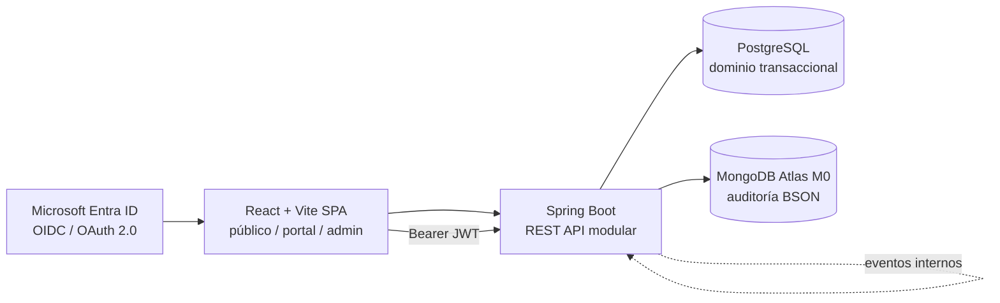

# CoffeeHub API

Sistema de gestión de suscripciones y despacho para un club de café de especialidad.

CoffeeHub es un caso de estudio orientado a demostrar competencias senior en
Spring Boot y React: monolito modular, arquitectura limpia, seguridad
empresarial, persistencia políglota, eventos internos, frontend SPA y gestión
de proyectos mediante Docs-as-Code. El producto se diseña para ejecutarse
localmente y desplegarse en la nube con un presupuesto de infraestructura de
**$0 USD**.

## Qué resuelve

- Catálogo de cafés, formatos, precios e inventario.
- Planes de suscripción mensual y trimestral.
- Registro del ciclo de cobro y las fechas de corte.
- Descuento automático de inventario después de una suscripción pagada.
- Alertas operativas cuando el stock cae bajo el umbral mínimo.
- Auditoría de eventos de negocio en una base documental NoSQL.
- Portal público, portal de clientes y consola administrativa en una SPA React.

## Arquitectura en una mirada



Los módulos se organizan por dominio:

| Módulo | Responsabilidad |
| --- | --- |
| `com.coffeehub.users` | Usuarios, identidad y autoridades `ROLE_CLIENT` / `ROLE_ADMIN`. |
| `com.coffeehub.catalog` | Cafés, bolsas, granos, precios e inventario. |
| `com.coffeehub.subscriptions` | Planes, suscripciones, cobros y fechas de corte. |
| `com.coffeehub.audit` | Captura pasiva de eventos y auditoría en MongoDB. |

El flujo de suscripción publica `SubscriptionPaidEvent` con
`ApplicationEventPublisher`. Catalog descuenta inventario y puede publicar una
alerta de stock bajo; audit persiste el detalle en MongoDB. No se incorporan
RabbitMQ ni Kafka: la comunicación es interna al monolito y evita
infraestructura innecesaria.

## Frontend y seguridad

- **SPA unificada**: React + Vite + Tailwind CSS, con React Router.
- **Rutas**: `/` público, `/portal/*` para `ROLE_CLIENT` y `/admin/*` para
  `ROLE_ADMIN`.
- **Identidad**: Microsoft Entra ID mediante `@azure/msal-react` y OAuth 2.0
  PKCE en el navegador.
- **API**: Spring Security OAuth2 Resource Server valida el Bearer JWT y sus
  App Roles en `/api/v1/**`.
- **Componentes**: PrimeReact, Mantine UI o Shadcn UI para tablas, gráficos y
  formularios.

## Stack tecnológico

| Capa | Selección | Alternativa evaluada |
| --- | --- | --- |
| Backend core | Java 17/21 LTS + Spring Boot 3.x | Kotlin + Spring Boot |
| Frontend SPA | React + Vite + Tailwind CSS | Next.js / Vue.js |
| SQL | PostgreSQL | Neon, Render PostgreSQL o Supabase |
| NoSQL | MongoDB / Atlas M0 | Amazon DocumentDB |
| Autenticación | Microsoft Entra ID + MSAL.js | Keycloak / Auth0 |
| Pruebas API | JUnit 5 + Testcontainers | H2 |
| API | Springdoc-OpenAPI + Swagger UI | Postman Collections |
| Despliegue | Render/Railway + Vercel | AWS EC2 / Netlify |

## Inicio rápido

### Prerrequisitos

- Java 17 o 21 y Node.js con npm.
- Docker Desktop y Docker Compose.
- Una aplicación registrada en Microsoft Entra ID para los flujos protegidos.

### Servicios locales

```bash
docker compose up -d
```

La configuración local levanta PostgreSQL en `localhost:5432` y MongoDB en
`localhost:27017`. Las credenciales de desarrollo deben mantenerse en variables
de entorno y nunca incluirse en el repositorio.

Variables mínimas esperadas para el backend:

```text
DB_URL=jdbc:postgresql://localhost:5432/coffeehub_db
DB_USERNAME=postgres
DB_PASSWORD=password
MONGODB_URI=mongodb://localhost:27017/coffeehub
AZURE_TENANT_ID=<tenant-id>
AZURE_CLIENT_ID=<client-id>
AZURE_CLIENT_SECRET=<client-secret>
```

> Los nombres exactos deben alinearse con el `application.yml` de la
> implementación. El secreto de Entra ID es confidencial y no debe registrarse.

La SPA requiere además la configuración pública de MSAL (Client ID, Tenant ID
e instancia de Entra ID) mediante variables `VITE_*`. El frontend obtiene el
token con PKCE y lo adjunta como `Authorization: Bearer` en las peticiones a
`/api/v1/**`.

### Documentación local

```bash
pip install mkdocs-material
mkdocs serve -f docs/mkdocs.yml
```

La documentación se publica automáticamente en GitHub Pages cuando se modifica
`docs/**`, `README.md` o la configuración del workflow en la rama `main`.

## Estructura Docs-as-Code

```text
.
├── .github/
│   └── workflows/docs.yml
├── docs/
│   ├── SCOPE.md
│   ├── PLANNING.md
│   ├── INFRASTRUCTURE.md
│   ├── GETTING_STARTED.md
│   └── adr/
├── backend/
│   └── Dockerfile
├── frontend/
│   └── Dockerfile
├── mkdocs.yml
├── docker-compose.yml
└── README.md
```

- [Alcance y criterios de aceptación](docs/SCOPE.md)
- [Planificación y WBS](docs/PLANNING.md)
- [Arquitectura e infraestructura](docs/INFRASTRUCTURE.md)
- [Guía de configuración](docs/GETTING_STARTED.md)
- [Registros de decisiones (ADR)](docs/adr/)

## Estado del proyecto

La documentación define el caso de estudio, el alcance y la arquitectura
objetivo. Los entregables de cada fase se validan mediante compilación,
pruebas automatizadas y revisión de los criterios de aceptación descritos en
`docs/SCOPE.md`.
