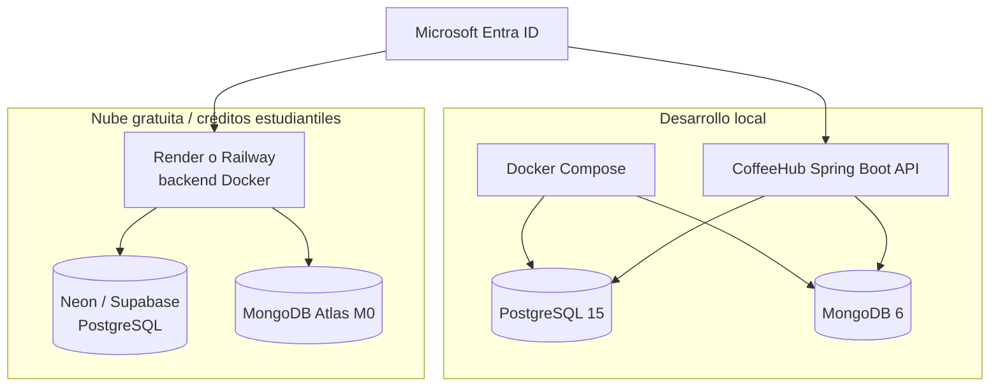
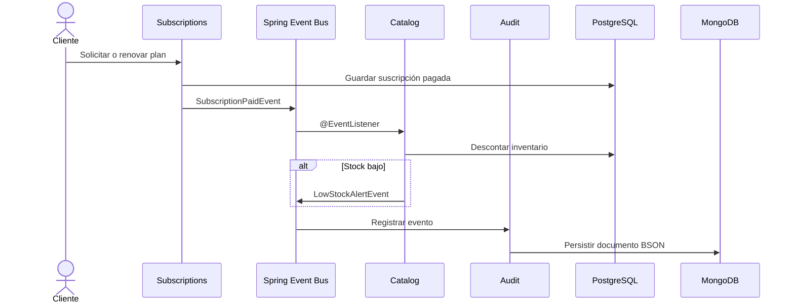

# Arquitectura e infraestructura

## Vista de despliegue

CoffeeHub API se despliega como un backend Spring Boot que expone servicios REST y coordina almacenamiento transaccional y de auditoría. El sistema mantiene PostgreSQL y MongoDB como dependencias separadas, con un punto de entrada único para el dominio de negocio.



## Componentes y responsabilidades

| Componente | Responsabilidad | Persistencia |
| --- | --- | --- |
| `users` | Identidad, usuarios y authorities desde claims JWT | PostgreSQL |
| `catalog` | Productos, precios, stock y umbral mínimo | PostgreSQL |
| `subscriptions` | Planes, cobros, estado y fechas de corte | PostgreSQL |
| `audit` | Eventos y trazabilidad sin bloquear el flujo principal | MongoDB |
| Spring Security | Validación de JWT y App Roles en el backend | Microsoft Entra ID |

## Flujo transaccional



El bus de eventos es el mecanismo de desacoplamiento entre módulos. No sustituye un sistema de mensajería distribuido: si en el futuro se requiere escalado independiente, el contrato de los eventos permitirá migrar esta comunicación a un broker.

## Configuración local

`docker-compose.yml` debe proveer:

```yaml
services:
  postgres:
    image: postgres:15-alpine
    environment:
      POSTGRES_DB: coffeehub_db
      POSTGRES_USER: postgres
      POSTGRES_PASSWORD: password
    ports: ["5432:5432"]
  mongo:
    image: mongo:6.0
    ports: ["27017:27017"]
```

Las credenciales anteriores son exclusivamente de desarrollo. En nube se reemplazan por secretos del proveedor y conexiones TLS.

## Observabilidad y operación

- Spring Boot Actuator expone health checks para el runtime.
- Los eventos auditables se conservan en MongoDB con su tipo, actor, fecha y payload relevante.
- Los logs no deben incluir tokens, secretos ni datos sensibles.
- Los health checks deben probar conectividad con las dependencias antes de declarar la aplicación lista.

## Evolución

El límite por módulo permite separar `subscriptions`, `catalog` o `audit` en servicios independientes si el volumen lo justifica. Esa evolución requeriría un contrato de eventos durable, observabilidad distribuida y una revisión de costos; no forma parte del alcance actual.