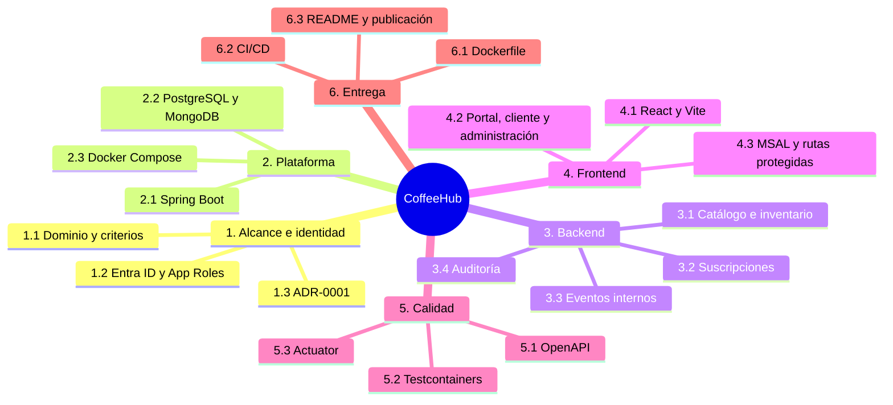
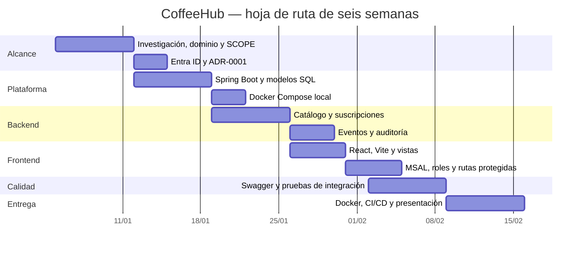

# Planificación Lean y WBS

## Enfoque

El trabajo se organiza en seis semanas con una dedicación estimada de 10 a 12
horas semanales. Cada fase produce un incremento verificable y su
documentación vive en el repositorio. El orden prioriza primero las decisiones
que desbloquean el resto del diseño, pero permite validar temprano la
infraestructura.

## WBS

## Cronograma

Las fechas son una referencia relativa para el plan de seis semanas; el
seguimiento real se realiza mediante issues y pull requests.

## Entregables por fase

| Semana | Fase | Actividades | Entregable |
| --- | --- | --- | --- |
| 1 | Investigación y alcance | Dominio, Entra ID, alcance y ADR | `SCOPE.md`, ADR-0001 |
| 2 | Infraestructura y datos | Spring Boot, Compose y entidades PostgreSQL | Proyecto compilable y bases locales |
| 3 | Backend y REST API | Catálogo, suscripciones, listeners, MongoDB y Swagger | Endpoints REST funcionales |
| 4 | Frontend y auth | React, Vite, MSAL, vistas y rutas protegidas | SPA conectada a la API |
| 5 | Pruebas y calidad | Testcontainers y flujos OIDC del frontend | Suite y tokens validados |
| 6 | DevOps y despliegue | Dockerfile, Render/Vercel, README y diagramas | Repositorio listo para portafolio |

## Definición de terminado

Una tarea se considera terminada cuando el código compila, las pruebas
relevantes pasan, la documentación relacionada está actualizada y existe una
revisión mediante pull request. Los cambios de arquitectura requieren un ADR
nuevo o una actualización explícita del ADR correspondiente.