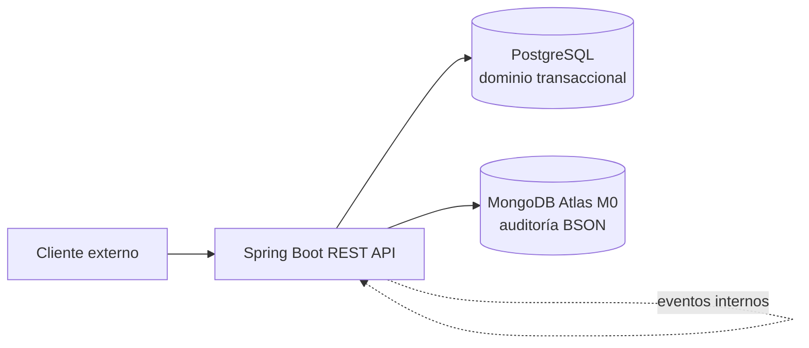

# CoffeeHub API

Sistema de gestión de suscripciones y despacho para un club de café de especialidad.

CoffeeHub API es el módulo backend del caso de estudio. Su responsabilidad es administrar el dominio de catálogo, suscripciones, seguridad, eventos y auditoría para apoyar una solución de café de especialidad con una arquitectura modular y una API REST segura.

## Qué resuelve

- Catálogo de cafés, formatos, precios e inventario.
- Planes de suscripción mensual y trimestral.
- Registro del ciclo de cobro y las fechas de corte.
- Descuento automático de inventario después de una suscripción pagada.
- Alertas operativas cuando el stock cae bajo el umbral mínimo.
- Auditoría de eventos de negocio en una base documental NoSQL.
- Exposición de servicios protegidos para clientes y administración.

## Arquitectura en una mirada



Los módulos se organizan por dominio:

| Módulo | Responsabilidad |
| --- | --- |
| `com.coffeehub.users` | Usuarios, identidad y autoridades `ROLE_CLIENT` / `ROLE_ADMIN`. |
| `com.coffeehub.catalog` | Cafés, bolsas, granos, precios e inventario. |
| `com.coffeehub.subscriptions` | Planes, suscripciones, cobros y fechas de corte. |
| `com.coffeehub.audit` | Captura pasiva de eventos y auditoría en MongoDB. |

El flujo de suscripción publica `SubscriptionPaidEvent` con `ApplicationEventPublisher`. Catalog descuenta inventario y puede publicar una alerta de stock bajo; audit persiste el detalle en MongoDB. No se incorporan RabbitMQ ni Kafka: la comunicación es interna al monolito y evita infraestructura innecesaria.

## Seguridad y acceso

- **Autenticación**: Microsoft Entra ID mediante OAuth 2.0 / OIDC.
- **Autorización**: App Roles `ROLE_CLIENT` y `ROLE_ADMIN`.
- **Protección de endpoints**: Spring Security valida JWT para `/api/v1/**`.
- **Auditoría**: eventos de negocio y trazabilidad de acciones relevantes.
- **Seguridad de configuración**: secretos y credenciales externos vía variables de entorno.

## Stack tecnológico

| Capa | Selección | Alternativa evaluada |
| --- | --- | --- |
| Backend core | Java 17/21 LTS + Spring Boot 3.x | Kotlin + Spring Boot |
| SQL | PostgreSQL | Neon, Render PostgreSQL o Supabase |
| NoSQL | MongoDB / Atlas M0 | Amazon DocumentDB |
| Autenticación | Microsoft Entra ID + OIDC | Keycloak / Auth0 |
| Pruebas API | JUnit 5 + Testcontainers | H2 |
| API | Springdoc-OpenAPI + Swagger UI | Postman Collections |
| Despliegue | Render/Railway + Docker | AWS EC2 |

## Inicio rápido

### Prerrequisitos

- Java 17 o 21 y Maven o Gradle.
- Docker Desktop y Docker Compose.
- Una aplicación registrada en Microsoft Entra ID para los flujos protegidos.

### Servicios locales

```bash
docker compose up -d
```

La configuración local levanta PostgreSQL en `localhost:5432` y MongoDB en `localhost:27017`. Las credenciales de desarrollo deben mantenerse en variables de entorno y nunca incluirse en el repositorio.

Variables mínimas esperadas para el backend:

```text
DB_URL=jdbc:postgresql://localhost:5432/coffeehub_db
DB_USERNAME=postgres
DB_PASSWORD=password
MONGODB_URI=mongodb://localhost:27017/coffeehub
AZURE_TENANT_ID=<tenant-id>
AZURE_CLIENT_ID=<client-id>
AZURE_CLIENT_SECRET=<client-secret>
```

> Los nombres exactos deben alinearse con el `application.yml` de la implementación. El secreto de Entra ID es confidencial y no debe registrarse.

### Documentación local

```bash
pip install mkdocs-material
mkdocs serve -f docs/mkdocs.yml
```

La documentación se publica automáticamente en GitHub Pages cuando se modifica `docs/**`, `README.md` o la configuración del workflow en la rama `main`.

## Estructura Docs-as-Code

```text
.
├── .github/
│   └── workflows/docs.yml
├── docs/
│   ├── SCOPE.md
│   ├── PLANNING.md
│   ├── INFRASTRUCTURE.md
│   ├── GETTING_STARTED.md
│   └── adr/
├── backend/
│   └── Dockerfile
├── mkdocs.yml
├── docker-compose.yml
├── pom.xml
└── README.md
```

- [Alcance y criterios de aceptación](SCOPE.md)
- [Planificación y WBS](PLANNING.md)
- [Arquitectura e infraestructura](INFRASTRUCTURE.md)
- [Guía de configuración](GETTING_STARTED.md)
- [Registros de decisiones (ADR)](adr/)

## Estado del proyecto

La documentación define el caso de estudio, el alcance y la arquitectura objetivo del backend. Los entregables de cada fase se validan mediante compilación, pruebas automatizadas y revisión de los criterios de aceptación descritos en `SCOPE.md`.